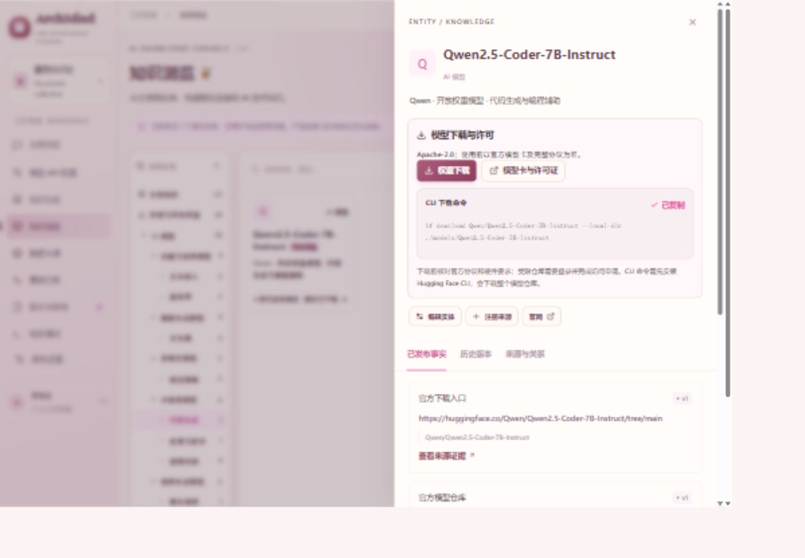

# ArchMind · AI 技术知识平台

ArchMind 是通过对话生成解决方案的 AI 知识平台。用户配置自己的模型 API，描述需求后，Agent 从后台同一套已发布知识中检索资料，生成带来源引用的方案，并支持连续追问。后台保留“来源 → 巡检 → 快照 → 证据候选 → 审核 → 事实版本 → 检索追踪”的工作流。

技术栈：Python 3.12 / FastAPI / SQLAlchemy / Alembic，React 19 / TypeScript / Vite，PostgreSQL 16；SQLite 可用于轻量本地体验。

## 实际运行截图

以下截图来自 2026-11-07 本地实际运行的统一知识浏览界面。已增加 GitHub Pages 静态体验构建，部署方式见下文。



早期演示数据验收截图仍保存在 `docs/screenshots/`。

GitHub Pages 的展示方案见 [面试演示部署说明](docs/github-pages.md)。

## GitHub Pages 体验模式

公开站：[ArchMind 在线体验](https://liqingqing001.github.io/ArchMind/)。复用当前对话、知识库和知识管理界面；支持 116 个公开知识条目、下载、引用、历史和审核模拟。未配置 API 时使用明确标注的静态演示；点击右上角“连接模型”，可在浏览器保存自己的 API Key、地址和模型 ID，直接调用模型。接口需允许浏览器跨域访问（CORS），错误会明确显示。配置与对话仅保存在访客浏览器，密钥不写进知识或检索记录；自动采集仍需完整后端。

```bash
cd frontend
npm ci
npm run test:demo
npm run build:demo
```

合并 main 后由 Pages 工作流自动发布；仓库已开启 GitHub Actions 发布来源，部署状态见 Actions。详见 [Pages 部署和验收](docs/github-pages.md)。

本地与云端并行开发遵循 [协作约定](docs/collaboration.md)：开工前同步最新 main，在独立分支开发，PR 合并前再次检查远端，不覆盖或强推共享分支。

## 获取项目

```bash
git clone https://github.com/Liqingqing001/ArchMind.git
cd ArchMind
```

## 本地快速启动

需要 Python 3.12+、Node.js 22+。以下命令适用于 Windows PowerShell，打开三个终端：

```powershell
# 终端一：迁移、可选演示数据、启动 API
cd backend
py -3.12 -m venv .venv
$env:VIRTUAL_ENV = (Resolve-Path .venv).Path
py -m pip install -e . pytest
py -m alembic upgrade head
py -m app.seed  # 可选：只向空库写入明确标识的演示数据
py -m uvicorn app.main:app --host 127.0.0.1 --port 8000 --reload
```

```bash
# 终端二：启动前端，访问 http://localhost:5173
cd frontend
npm ci
npm run dev
```

```powershell
# 终端三：自动巡检（只启动一个实例）
cd backend
$env:VIRTUAL_ENV = (Resolve-Path .venv).Path
py -m app.worker
```

默认使用 backend/knowledge.db。API 文档：http://127.0.0.1:8000/docs 。前端通过 Vite 代理访问 API。未配置口令时仅用于本机；生产使用 Docker 的管理口令模式。

首页为“方案对话”；点击右上角“连接模型”，在弹窗中选择服务商、填写 API Key 与模型 ID，测试后保存。支持 Chat Completions、Responses、Claude Messages 三种协议和 9 个服务商预设，也可填写自定义公开 HTTPS 地址。侧栏只保留对话、知识库、知识管理三个入口；新建、搜索、切换、重命名、删除与撤销对话在历史列表完成。对话与引用保存在项目数据库，刷新后恢复；API 设置单独保存在浏览器，刷新后恢复；可在模型设置中清除，不写入会话或检索记录。20 个开源与开放权重模型统一纳入“知识总览”和“知识浏览”；知识库按“生成类 / 理解类 → 模型类型 → 厂家 → 具体模型”逐层浏览，同厂家集中展示；开放权重作为模型标签保留，全部知识首页只展示能力分组；实体详情提供官方权重、许可证与下载命令。详细说明见 [分层知识目录](docs/knowledge-navigation.md) 与 [对话与模型知识](docs/solution-workspace.md)。

开发前端统一代理到 `http://127.0.0.1:8000`，避免多个前端端口连接到新旧不同的后端。模型配置出现“Not Found”时，需确认已重启新版后端；开发模式的 `--reload` 会自动加载代码更新。补充官方知识的导入命令见 [知识目录](docs/knowledge-catalog.md)。

本地切换 PostgreSQL：在 API、迁移、worker 的终端中设置同一个 `DATABASE_URL=postgresql+psycopg://用户名:密码@地址:5432/数据库`。本地 API 使用 `ADMIN_TOKEN` 环境变量启用口令；前端收到 401 后显示登录入口，不将口令写入磁盘或 localStorage。

## Docker 运行（PostgreSQL + API/前端 + 独立调度）

```bash
cp .env.example .env
# 编辑 .env：分别填写 POSTGRES_PASSWORD 与 ADMIN_TOKEN；接入 Agent 时另设 KNOWLEDGE_TOKEN
# 各口令使用不同的随机十六进制字符串：py -c "import secrets; print(secrets.token_hex(32))"
docker compose up --build -d
# 可选：导入演示数据。已有实体时跳过。
docker compose --profile demo run --rm seed
```

访问 http://localhost:8000 ，输入 `.env` 中的 `ADMIN_TOKEN`。生产前端与 API 同源；数据写入 PostgreSQL 持久卷。数据库不对宿主机暴露端口，Web 默认仅绑定 127.0.0.1。云服务器公开访问请加 HTTPS 反向代理，并在网络层禁止采集器访问内网/云元数据；不要直接公开无口令开发服务。

`docker compose logs -f worker` 查看调度日志；`docker compose logs -f api` 查看接口日志。普通 `docker compose down` 保留数据库卷；`down -v` 会删除数据，不要用于日常停止。

## 首次验收路径

1. 知识浏览 → 新建一个真实实体，可选择多个分类；厂商、品牌、具体模型、API 分别建立。
2. 数据来源 → 注册该实体的公开 HTTPS 文档 → 立即巡检。支持网页、文本、JSON、GitHub 公开页面和 RSS 正文；不自动跟随跳转。
3. 查看快照，确认规范化正文、原始响应、时间和 SHA-256。仅页面变化不发布事实。
4. 基于快照提交字段、新值、逐字原文证据，或使用下方 JSON 协议生成候选。
5. 版本与审核 → 核对原文 → 审核发布或驳回。相同候选不会重复生成，过期候选禁止覆盖新版本。
6. 实体详情 → 已发布事实 / 历史版本 → 提交恢复候选，审核后形成新版本。
7. 检索调试 → 输入字段或实体名 → 查看已发布事实及引用链路，保留 trace ID 可回查当时的版本。

演示数据包含 12 个条目，只有“演示模型 · Atlas”拥有虚构事实与审核候选。演示来源不会向网络发请求，所有参数均非真实规格。空库不自动注入示例。

## 结构化抽取协议

来源类型选择“结构化 JSON”，来源响应格式如下：

```json
{
  "documentation": "上下文窗口：128K tokens",
  "facts": [
    {
      "key": "上下文窗口",
      "value": "128K tokens",
      "evidence": "上下文窗口：128K tokens"
    }
  ]
}
```

facts 最多 100 条，必须另有独立 documentation 原文；自动候选的新值须直接出现在证据中。证据须存在于规范化正文，字段格式有效；抽取结果只进入待审核。普通网页由人录入候选。正文变化通过哈希判断，支持 ETag / Last-Modified 条件请求；失败会记录日志并在下次周期重试，也可手动重试。来源暂停、检查周期可在后台修改。

## 检查与测试

```powershell
cd backend
$env:VIRTUAL_ENV = (Resolve-Path .venv).Path
py -m pytest -q
py -m alembic check
cd ../frontend
npm run build
```

PostgreSQL 集成测试必须用**独立的空测试库**，测试会清空其应用表：

```powershell
cd backend
$env:TEST_DATABASE_URL = 'postgresql+psycopg://.../knowledge_test'
py -m pytest -q
```

CI 同时运行 SQLite / PostgreSQL 后端测试及 TypeScript / 前端生产构建。

## 文档与后续范围

- [联网补充的真实知识目录（116 个条目、211 条事实）](docs/knowledge-catalog.md)
- [本次界面调整、知识分类细化与后续完善清单](docs/improvements.md)
- [Agent 与可见知识库的连接](docs/agent-knowledge.md)
- [需求与验收](docs/requirements.md)
- [架构和技术决策](docs/architecture.md)
- [运维与恢复](docs/operations.md)
- [交付验证记录](docs/validation.md)

当前已接入用户自选 LLM、多会话历史、连续追问、关键词知识检索和逐项来源引用，支持 Markdown 对话导出；未实现 Embedding、pgvector、精确成本计算、PDF/Word 报告导出和多租户权限。后续优先建立检索评测集，再完善文档切片与混合检索。
