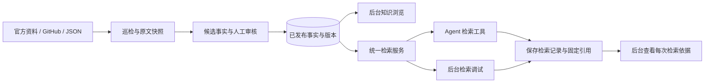

# 后台可见的知识库 = Agent 检索的知识库

本项目只有一套核心知识数据。后台用来管理、审核、浏览这些数据；Agent 用工具读取同一数据库中的已发布事实。无需把后台数据复制到一个看不见的 Agent 私有知识库。



## 当前已经实现

- 共享服务：`backend/app/knowledge.py:retrieve`。
- 后台入口：`GET /api/search?q=关键词`，可包含演示数据，便于验证空库流程。
- Agent 入口：`POST /api/knowledge/retrieve`，默认排除演示数据，只返回当前已发布事实。
- 查询支持实体 ID、分类（含后代）、实体类型、结果数量筛选。
- 返回事实 ID、实体、字段、值、版本、原文证据、来源 URL、快照 ID、哈希、采集时间和 trace ID。
- `GET /api/traces` 列出最近检索，可按 `caller=agent` 筛选；后台“检索调试”直接展示这张表。
- `GET /api/traces/{id}` 固定保留当时命中的引用，即使事实后续被新版替换，也能看清旧对话使用的版本。
- 待审核/已驳回候选不参与检索；新版本发布立即生效，不需要人工同步另一套索引。

检索实现仍是关键词匹配。它不理解任意自然语言，Agent 应把问题拆成短关键词或实体名调用；没有结果时说明知识不足。后续语义检索也必须从同一发布流程建立派生索引，并保留实体、事实和快照的关联，不另行维护第二份真相。

## Agent 访问口令

在 API 运行环境设置独立随机 `KNOWLEDGE_TOKEN`，只给 Agent 这个口令。`ADMIN_TOKEN` 留给后台管理员，不传入模型上下文。Compose 中两个变量从根目录 .env 读取。

Agent 口令只能调用 `POST /api/knowledge/retrieve`，不能修改实体、注册来源、执行审批或浏览其他调用的检索历史。工具可以提交 `request_id` 关联对话/任务/工具调用编号，后台会显示这个编号。不要把客户隐私或密钥放入 request_id。

未设置 KNOWLEDGE_TOKEN 时，受保护实例需要管理员口令才能调用该接口；仅用于本地无口令启动时可无口令调用。实际接入 Agent 前建议配置独立口令。

## 调用示例

```http
POST /api/knowledge/retrieve
Authorization: Bearer <KNOWLEDGE_TOKEN>
Content-Type: application/json

{
  "query": "上下文",
  "kind": "model",
  "top_k": 10,
  "include_demo": false,
  "request_id": "conversation-123:tool-call-1"
}
```

适配示例：`backend/examples/agent_tool.py` 包含 OpenAI 兼容 function 工具定义 `TOOL`，以及实际发 HTTP 请求的 `search_archmind_knowledge` 函数。可在未来的 Agent tool dispatcher 中注册它，返回结果给模型时保留 trace_id 与引用。

```bash
cd backend
# 在 shell/进程管理器配置 ARCHMIND_URL 和 KNOWLEDGE_TOKEN，不要把值写到仓库或提示词中。
uv run python -m examples.agent_tool 上下文
```

后台“检索调试”中选择“模拟 Agent 工具调用”即可测试同一接口；如果使用演示库，显式勾选“包含演示数据”。模拟记录会显示“Agent（调试）”，真实工具请求显示“Agent”。记录列表可手动刷新查看新调用。

## 下一阶段

当前交付的是实际可调用的检索工具及可见审核链路，还没有配置任何大模型，也没有聊天式 Agent 编排。接入模型后，Agent 应通过这个工具选型、引用和生成方案；不能把模型记忆中的价格或能力伪装成已验证事实。
