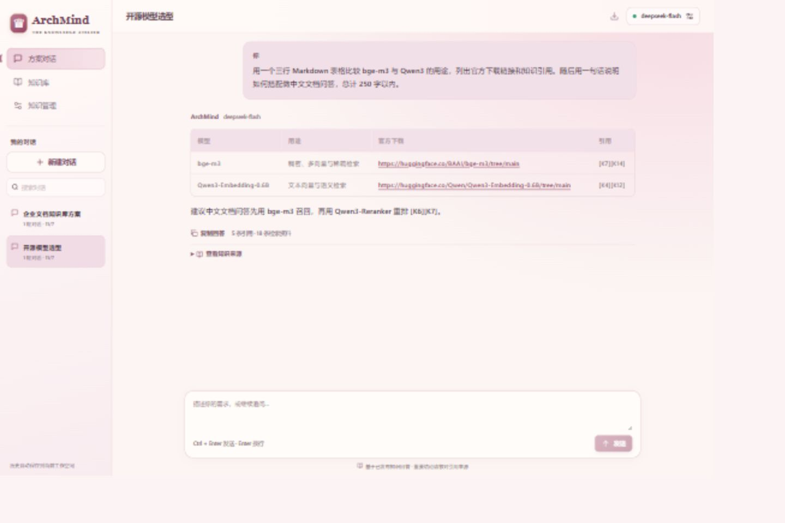
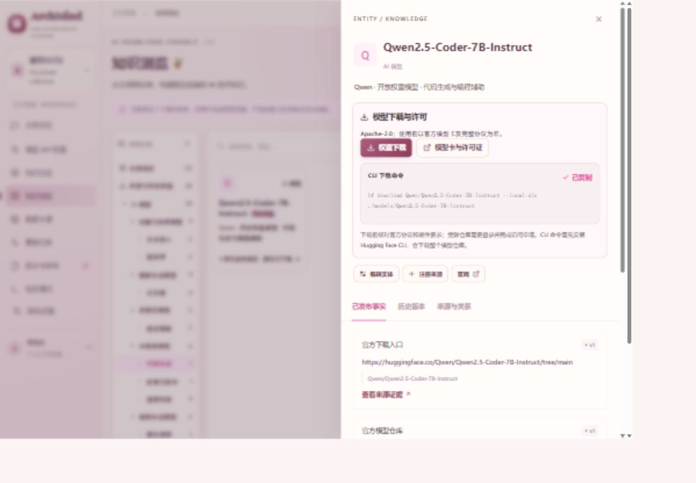

# 方案对话与统一模型知识

## 使用路径

默认首页为“方案对话”。侧栏保留“方案对话、知识库、知识管理”三个入口，来源、更新、审核、检索调试和系统设置收在知识管理页。聊天去掉重复页头和大段欢迎说明，消息区独立滚动，输入框固定在底部。小屏可从工具栏打开历史列表。

点击对话右上角“连接模型”，选择服务商并填写 API Key 和模型 ID，测试后保存。API 地址、协议、输出上限在高级设置中；可粘贴 Base URL 或完整接口路径。切换服务商会清空弹窗中的密钥，取消弹窗不会修改当前连接。

| 协议 | 用途与预设 |
| --- | --- |
| Chat Completions | DeepSeek、Gemini 兼容接口、百炼、硅基流动、火山方舟、OpenRouter、Mistral，以及自定义兼容服务 |
| Responses | OpenAI 原生接口，使用 max_output_tokens，关闭服务端响应存储 |
| Claude Messages | Anthropic 原生接口，独立 system 字段、x-api-key 与版本请求头 |

官方接入依据：[DeepSeek](https://api-docs.deepseek.com/)、[OpenAI](https://developers.openai.com/api/docs/guides/text)、[Anthropic](https://platform.claude.com/docs/en/api/overview)、[Gemini](https://ai.google.dev/gemini-api/docs/openai)、[百炼](https://help.aliyun.com/zh/model-studio/base-url)、[硅基流动](https://docs.siliconflow.cn/docs/userguide/quickstart)、[火山方舟](https://docs.volcengine.com/docs/ark/compatible-with-openai-sdk)、[OpenRouter](https://openrouter.ai/docs/quickstart)、[Mistral](https://docs.mistral.ai/api/endpoint/chat)。其他服务商的模型名称留空，由用户填写实际可用的 ID；地域、业务空间和 Coding Plan 可能使用不同地址。这里只接入文本生成，接口地址沿用公开 HTTPS 限制。

## 多会话与回答

- 在历史区新建、搜索、切换和重命名会话；删除后可立即撤销。
- 数据库保存每段对话的用户消息、模型回答、当轮引用与检索证据，刷新后恢复。每段对话有独立上下文。
- 生成期间可查看别的会话或新建会话；回复只写入发起请求的会话。当前同一页面一次生成一条回复，避免重复提交。
- 后端从当前会话读取最近最多 9 轮完整上下文，并按字符数缩短过长历史。版本校验防止多个页面并发生成时覆盖已有记录。
- 请求失败保留草稿，未成功的消息对不写入历史。生成期间重命名不会被自动标题覆盖；删除后的对话不会因迟到回复重新出现。
- 支持 Markdown 标题、表格、列表与代码块，复制回答和导出当前对话 Markdown。引用折叠在“查看知识来源”下，可打开来源快照。
- Ctrl + Enter 发送，Enter 换行。阅读旧消息时不会强制跳到底部，可点击“回到最新消息”。

用户描述需求后，后端从同一数据库读取已发布、非演示事实，按本轮需求和历史用户消息排序后交给所选模型。引用对应事实版本、快照与哈希。当前检索为关键词排序，尚不是向量检索。

API Key 与模型设置独立保存在当前浏览器 localStorage，刷新后恢复，可在“连接模型”中清除。密钥不写进数据库、对话、检索记录或源码。完整后端版通过 FastAPI 调用模型，Pages 版直接从浏览器调用所选 HTTPS 地址（需供应商支持 CORS）。模型服务会收到近期对话与匹配知识。Trace 记录查询与证据，Conversation 单独保存回答。历史属于当前单工作空间，共用现有管理口令权限，尚不提供多用户隔离。

现有数据库需在 backend 目录运行 `py -m alembic upgrade head`，新增迁移 `c921db332001` 创建 conversations 表。

## 模型目录

20 个模型统一纳入“知识浏览”和“知识总览”，覆盖语言、代码、视觉理解、图像生成、视频生成、语音与音频、嵌入与排序。取消“全部 / 开源”范围切换，统一从“生成类 / 理解类 → 类型 → 厂家 → 模型”逐层浏览；开放权重保留为模型标签，多能力模型共用同一实体；实体详情提供权重下载、模型卡与许可证和 CLI 下载命令，没有独立模型目录页。

资料核对日期为 2026-11-07。开放权重不等于无限制开源；受限仓库需要自行登录并同意条款或申请权限，未下载大型权重。页面读取后台当前已发布事实生成的 model_resources，审核更新同步到详情；演示、待审核及归档下载事实不生成入口。

导入底稿为 backend/data/open-model-catalog-2026-11-07.json，不是运行时的另一套配置。运行 `node scripts/sync-open-models.mjs` 生成数据集，再用 `import-official-knowledge.mjs --dataset=backend/data/open-model-knowledge-2026-11-07.json --apply` 导入；重复导入不新增重复事实，冲突进入审核流程。共补入 20 个实体、80 条事实；与上一批合计 116 个真实实体、211 条事实。

## 验证记录

- 后端：60 passed，1 skipped（未配置独立 PostgreSQL 测试库）。覆盖历史 CRUD、持久化与证据保存、上下文隔离、失败不落库、并发冲突、生成期间改名/删除，以及三种协议请求与响应。
- 数据库迁移已到 c921db332001，Alembic check 无待生成差异。前端 TypeScript / Vite 生产构建通过。
- DeepSeek 在 5173 页面真实连接成功；其他服务商预设已参考官方文档，协议适配通过模拟响应测试，未逐家进行真实付费调用。
- 浏览器实测两段独立对话：开源模型选型表格（5 条引用）和企业文档知识库方案（8 条引用）。生成期间新建及切换会话、标题修改、搜索、删除撤销、刷新恢复均通过；复制回答与 Markdown 导出内容已核对，来源快照能正常打开。
- 桌面与手机首屏输入框可见，页面无横向溢出；窄屏表格在自身容器横向滚动，历史列表可展开切换。知识浏览现按能力和厂家逐层展示，详见 [分层知识目录](knowledge-navigation.md)。
- 5173、5174 统一代理 8000；后端开发热更新生效。原先 Not Found 来自旧版 8000 服务没有模型接口；缺少接口时现在会给出明确提示。
- 继续保留蔷薇粉、奶油白、香槟金与宫廷徽章，并提高字重和对比度。桌面知识卡片每行 4 个；滚动页面可点击“回到顶部”或 Alt + ↑。

知识尚未全面覆盖显存、量化、并发、价格与性能参数。回答应明确假设，未证实规格标为待核验；后续优先建立检索评测集，再升级混合检索。

